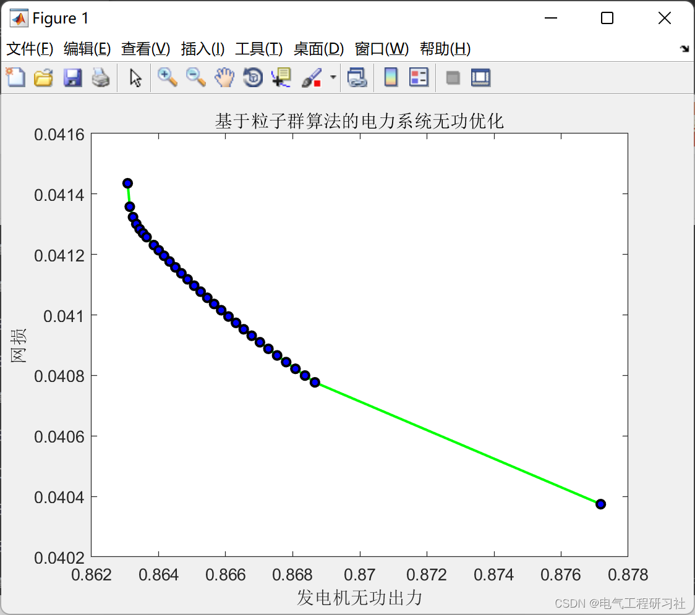
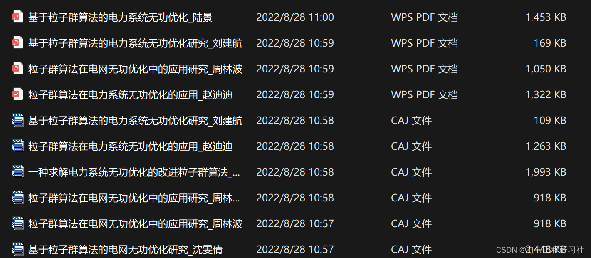

# Research on Reactive Power Optimization of Electric Power System Based on Particle Swarm Algorithm (IEEE14-bus) (Matlab Code Implementation)

1. Overview
In recent years, various heuristic optimization algorithms have been applied to reactive power optimization in power systems and have achieved good results, but they are prone to premature convergence and local convergence issues. Particle Swarm Optimization (PSO) is an evolutionary computing method invented from the study of bird flocking behavior. The PSO algorithm has advantages such as global convergence, generality, and strong robustness, which makes it suitable for solving optimization problems with no continuity or differentiability requirements. It has the ability to search globally and is simple to program. This paper uses the improved particle swarm algorithm to study the reactive power optimization in power systems, aiming to achieve reactive power optimization in actual power transmission.
2 Reactive Power Optimization Mathematical Model
The mathematical model of reactive power optimization consists of objective function, power constraints, and variable constraints. Typically, appropriate adjustments are made to generator terminal voltage, switching reactive compensation capacity, and transformer tap settings to ensure voltage quality while reducing network losses. From an economic perspective, minimizing active network losses is usually taken as the objective function:
N is the number of system branch sections involved in active network loss calculation; Gij is the conductance between nodes i and j; Vi and Vj are the voltages at nodes i and j, respectively. The control variables of reactive power optimization include generator terminal voltage, compensation point compensation amount, and adjustable transformer ratio; state variables include generator reactive output power and voltage values at all nodes. Constraint conditions for each variable include equality constraints and inequality constraints, among which equality constraints are the power flow equations [7], such as equation (2):
Other constraints are described in part 4.
3 Operational Results
4 Matlab Code and Article Reading
This article only showcases part of the code, and all code and more detailed articles can be found on the above link.
Edit
This paper takes the IEEE 14-bus as an example: here only showcases part of the code, all codes can be obtained by clicking the above link.
function [TransFormer_Branch, Normal_Branch, PQ_Node, PV_Node, Swing_Node, Node_Num] = RE_IEEE14_data()
5 Conclusions From the results in Figure 2 and Table 4, it can be seen that the power system's network losses decreased from 11.505 MVA to 7.91 MVA, and the voltage at each node also improved compared to before the use of the Particle Swarm Optimization (PSO) algorithm. This indicates that the PSO algorithm is fully feasible for reactive power optimization, with strong global search capability, fast convergence speed, good optimization effects, and ease of implementation, making it an ideal reactive power optimization algorithm. It can be concluded that based on the PSO algorithm for reactive power optimization, the convergence speed is fast, and it can precisely find the global optimal solution. The system's network loss significantly decreases, and the voltage values stabilize and improve accordingly, achieving the objectives of improving voltage quality, reducing network losses, and enhancing voltage stability through reactive power optimization.
6 References [1] Lu Jing, Tiao Xianguo, Peng Guili. Power System Reactive Power Optimization Based on Particle Swarm Algorithm [J]. Microcomputer and Application, 2017, 36(13): 19-21+25. DOI: 10.19358/j.issn.1674-7720.2017.13.007.  
[2] Sun Hua, Shen Fang. Application of Improving Particle Swarm Algorithm in Power System Reactive Power Optimization [J]. Heilongjiang Science and Technology Information, 2016(29): 80-81.  
[3] Xu Lei. Reactive Power Optimization Based on Improved Particle Swarm Algorithm [D]. Xihua University, 2016.  
[4] Zhao Didi, Wang Mengdi. Application of Particle Swarm Algorithm in Power System Reactive Power Optimization [J]. Information Technology and Informatization, 2021(09): 246-248.  
7 Conclusions Finally

## Images

<!-- PAYMENT_BLOCK -->

## Get this dataset

- Payment link (Stripe): [Buy now](https://buy.stripe.com/3cs8yP7sY87d0vu9AB)
- Payment QR code: 

<!-- /PAYMENT_BLOCK -->
